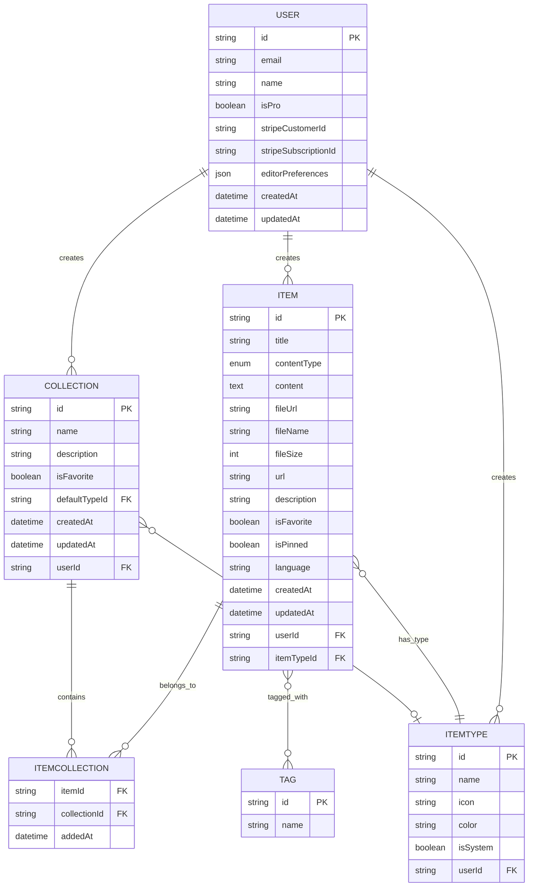
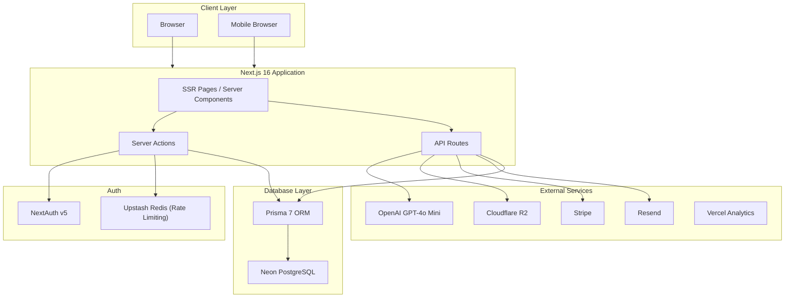
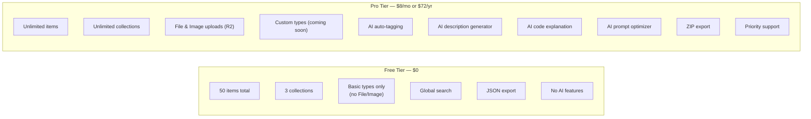

# DevStash — Project Overview

> A unified hub for developer knowledge & resources

---

## 📋 Table of Contents

- [Problem Statement](#-problem-statement)
- [Target Users](#-target-users)
- [Build Status](#-build-status)
- [Features](#-features)
- [Data Architecture](#-data-architecture)
- [Tech Stack](#-tech-stack)
- [Monetization](#-monetization)
- [UI/UX Guidelines](#-uiux-guidelines)
- [Project Structure](#-project-structure)
- [Development Workflow](#-development-workflow)
- [Coding Standards](#-coding-standards)
- [Future Features](#-future-features)
- [Next Steps](#-next-steps)

---

## 🎯 Problem Statement

Developers keep their essentials scattered across multiple tools and locations:

| Resource      | Common Location            |
| ------------- | -------------------------- |
| Code snippets | VS Code, Notion, Gists     |
| AI prompts    | Chat histories             |
| Context files | Buried in projects         |
| Useful links  | Browser bookmarks          |
| Documentation | Random folders             |
| Commands      | `.txt` files, bash history |
| Templates     | GitHub Gists               |

**The Result:** Context switching, lost knowledge, and inconsistent workflows.

**The Solution:** DevStash provides ONE fast, searchable, AI-enhanced hub for all developer knowledge & resources.

---

## 👥 Target Users

| User Type                      | Primary Needs                                      |
| ------------------------------ | -------------------------------------------------- |
| **Everyday Developer**         | Fast access to snippets, prompts, commands, links  |
| **AI-First Developer**         | Save prompts, contexts, workflows, system messages |
| **Content Creator / Educator** | Store code blocks, explanations, course notes      |
| **Full-Stack Builder**         | Collect patterns, boilerplates, API examples       |

---

## 🏗️ Build Status

Completed features as of the latest session:

| Area                                                   | Status  |
| ------------------------------------------------------ | ------- |
| Initial Setup (Next.js 16, Tailwind v4, TypeScript)    | ✅ Done |
| Dashboard UI (sidebar, top bar, responsive layout)     | ✅ Done |
| Prisma + Neon PostgreSQL (full schema + seed)          | ✅ Done |
| NextAuth v5 (email/password + GitHub OAuth)            | ✅ Done |
| Email verification & password reset (Resend)           | ✅ Done |
| Items CRUD (create, read, update, delete)              | ✅ Done |
| Item Drawer (slide-in detail/edit panel)               | ✅ Done |
| Code Editor (Monaco, macOS styling)                    | ✅ Done |
| Markdown Editor (Write/Preview tabs, GFM)              | ✅ Done |
| File & Image Upload (Cloudflare R2)                    | ✅ Done |
| Collections CRUD                                       | ✅ Done |
| Collection-Item assignment (many-to-many)              | ✅ Done |
| Global Search / Command Palette (Cmd+K)                | ✅ Done |
| Favorites & Pinning                                    | ✅ Done |
| Pagination                                             | ✅ Done |
| Tags                                                   | ✅ Done |
| Rate Limiting (Upstash Redis)                          | ✅ Done |
| Stripe (checkout, webhooks, billing portal)            | ✅ Done |
| Feature gating (Pro limits enforced)                   | ✅ Done |
| AI Auto-Tagging (GPT, Pro only)                        | ✅ Done |
| AI Description Generator (Pro only)                    | ✅ Done |
| AI Explain Code (Pro only)                             | ✅ Done |
| AI Prompt Optimizer (Pro only)                         | ✅ Done |
| Import / Export (JSON free, ZIP Pro)                   | ✅ Done |
| Settings page (password, delete account, editor prefs) | ✅ Done |
| Homepage (marketing page, pricing toggle)              | ✅ Done |
| Vercel Analytics                                       | ✅ Done |

---

## ✨ Features

### A. Items & Item Types

Items are the core unit of DevStash. Each item has a type that determines its behaviour and appearance.

#### System Types (Immutable)

| Type       | Icon         | Color               | Content Type | Route             |
| ---------- | ------------ | ------------------- | ------------ | ----------------- |
| 🔷 Snippet | `Code`       | `#3b82f6` (blue)    | Text         | `/items/snippets` |
| 🟣 Prompt  | `Sparkles`   | `#8b5cf6` (purple)  | Text         | `/items/prompts`  |
| 🟠 Command | `Terminal`   | `#f97316` (orange)  | Text         | `/items/commands` |
| 🟡 Note    | `StickyNote` | `#fde047` (yellow)  | Text         | `/items/notes`    |
| ⚫ File    | `File`       | `#6b7280` (gray)    | File         | `/items/files`    |
| 🩷 Image   | `Image`      | `#ec4899` (pink)    | File         | `/items/images`   |
| 🟢 Link    | `Link`       | `#10b981` (emerald) | URL          | `/items/links`    |

> **Note:** File and Image types are Pro-only features.

### B. Collections

Users can organise items into collections. Items support many-to-many relationships with collections (one item can belong to multiple collections).

**Examples:** React Patterns, AI Workflows, DevOps, Terminal Commands, Design Resources.

### C. Search

- Global command palette via `Cmd+K` / `Ctrl+K`
- Searches across titles, content, tags, and collections
- Grouped results with type icons and keyboard navigation

### D. Authentication

- Email/password with verification via [Resend](https://resend.com)
- GitHub OAuth sign-in
- Forgot/reset password flow
- Powered by [NextAuth v5](https://authjs.dev)
- Rate-limited endpoints via [Upstash Redis](https://upstash.com)

### E. Core Features

- ⭐ Collection and item favourites
- 📌 Pin items to top
- 🕐 Recently used items on dashboard
- 📥 Import from JSON (free) or ZIP (Pro)
- ✍️ Markdown editor for Notes & Prompts (GFM, Write/Preview tabs)
- 💻 Monaco code editor for Snippets & Commands (syntax highlighting, macOS chrome)
- 📤 File & image upload to Cloudflare R2 (Pro)
- 💾 Export data (JSON free / ZIP Pro)
- 🌙 Dark mode default
- 🏷️ Multi-collection item assignment
- 👁️ View item's collection memberships
- ⚙️ Editor preferences (font size, tab size, word wrap, minimap, theme)

### F. AI Features (Pro Only)

Powered by OpenAI GPT — all features are rate-limited (20 req/hr) and Pro-gated.

| Feature                  | Description                                               |
| ------------------------ | --------------------------------------------------------- |
| 🤖 Auto-Tagging          | Suggests relevant tags based on item content              |
| 📝 Description Generator | Generates a short description from title/content/URL      |
| 💡 Explain Code          | Explains snippets/commands in plain language              |
| ⚡ Prompt Optimizer      | Rewrites prompts for better AI results with accept/reject |

---

## 🗄️ Data Architecture

### Entity Relationship Diagram



### Prisma Schema

```prisma
// prisma/schema.prisma

generator client {
  provider = "prisma-client-js"
}

datasource db {
  provider = "postgresql"
  url      = env("DATABASE_URL")
}

// ============================================
// ENUMS
// ============================================
enum ContentType {
  TEXT
  FILE
  URL
}

// ============================================
// USER
// ============================================
model User {
  id                   String    @id @default(cuid())
  email                String    @unique
  emailVerified        DateTime?
  name                 String?
  image                String?
  password             String?
  isPro                Boolean   @default(false)
  stripeCustomerId     String?   @unique
  stripeSubscriptionId String?   @unique
  editorPreferences    Json?     // { fontSize, tabSize, wordWrap, minimap, theme }
  createdAt            DateTime  @default(now())
  updatedAt            DateTime  @updatedAt

  items       Item[]
  collections Collection[]
  itemTypes   ItemType[]
  accounts    Account[]
  sessions    Session[]

  @@map("users")
}

// ============================================
// NEXTAUTH MODELS
// ============================================
model Account {
  id                String  @id @default(cuid())
  userId            String
  type              String
  provider          String
  providerAccountId String
  refresh_token     String? @db.Text
  access_token      String? @db.Text
  expires_at        Int?
  token_type        String?
  scope             String?
  id_token          String? @db.Text
  session_state     String?

  user User @relation(fields: [userId], references: [id], onDelete: Cascade)

  @@unique([provider, providerAccountId])
  @@map("accounts")
}

model Session {
  id           String   @id @default(cuid())
  sessionToken String   @unique
  userId       String
  expires      DateTime

  user User @relation(fields: [userId], references: [id], onDelete: Cascade)

  @@map("sessions")
}

model VerificationToken {
  identifier String
  token      String   @unique
  expires    DateTime

  @@unique([identifier, token])
  @@map("verification_tokens")
}

// ============================================
// ITEM
// ============================================
model Item {
  id          String      @id @default(cuid())
  title       String
  contentType ContentType
  content     String?     @db.Text // TEXT types
  fileUrl     String?               // R2 URL for FILE types
  fileName    String?               // Original filename
  fileSize    Int?                  // Size in bytes
  url         String?               // URL/link types
  description String?     @db.Text
  isFavorite  Boolean     @default(false)
  isPinned    Boolean     @default(false)
  language    String?               // For syntax highlighting
  createdAt   DateTime    @default(now())
  updatedAt   DateTime    @updatedAt

  userId     String
  user       User     @relation(fields: [userId], references: [id], onDelete: Cascade)
  itemTypeId String
  itemType   ItemType @relation(fields: [itemTypeId], references: [id])
  tags       Tag[]    @relation("ItemTags")
  collections ItemCollection[]

  @@index([userId])
  @@index([itemTypeId])
  @@index([createdAt])
  @@map("items")
}

// ============================================
// ITEM TYPE
// ============================================
model ItemType {
  id       String  @id @default(cuid())
  name     String
  icon     String
  color    String
  isSystem Boolean @default(false)

  userId String?
  user   User?   @relation(fields: [userId], references: [id], onDelete: Cascade)
  items  Item[]
  defaultForCollections Collection[]

  @@unique([name, userId])
  @@map("item_types")
}

// ============================================
// COLLECTION
// ============================================
model Collection {
  id          String   @id @default(cuid())
  name        String
  description String?  @db.Text
  isFavorite  Boolean  @default(false)
  createdAt   DateTime @default(now())
  updatedAt   DateTime @updatedAt

  userId        String
  user          User      @relation(fields: [userId], references: [id], onDelete: Cascade)
  defaultTypeId String?
  defaultType   ItemType? @relation(fields: [defaultTypeId], references: [id])
  items         ItemCollection[]

  @@index([userId])
  @@map("collections")
}

// ============================================
// ITEM-COLLECTION JOIN TABLE
// ============================================
model ItemCollection {
  itemId       String
  collectionId String
  addedAt      DateTime @default(now())

  item       Item       @relation(fields: [itemId], references: [id], onDelete: Cascade)
  collection Collection @relation(fields: [collectionId], references: [id], onDelete: Cascade)

  @@id([itemId, collectionId])
  @@map("item_collections")
}

// ============================================
// TAG
// ============================================
model Tag {
  id    String @id @default(cuid())
  name  String @unique
  items Item[] @relation("ItemTags")

  @@map("tags")
}
```

### Seed Data for System Types

```typescript
// prisma/seed.ts
import { PrismaClient } from "@prisma/client";

const prisma = new PrismaClient();

const systemItemTypes = [
  { name: "snippet", icon: "Code", color: "#3b82f6", isSystem: true },
  { name: "prompt", icon: "Sparkles", color: "#8b5cf6", isSystem: true },
  { name: "command", icon: "Terminal", color: "#f97316", isSystem: true },
  { name: "note", icon: "StickyNote", color: "#fde047", isSystem: true },
  { name: "file", icon: "File", color: "#6b7280", isSystem: true },
  { name: "image", icon: "Image", color: "#ec4899", isSystem: true },
  { name: "link", icon: "Link", color: "#10b981", isSystem: true },
];

async function main() {
  console.log("Seeding system item types...");
  for (const type of systemItemTypes) {
    await prisma.itemType.upsert({
      where: { name_userId: { name: type.name, userId: null } },
      update: {},
      create: type,
    });
  }
  console.log("Seeding complete!");
}

main()
  .catch((e) => {
    console.error(e);
    process.exit(1);
  })
  .finally(async () => {
    await prisma.$disconnect();
  });
```

> **Database Migrations — Important**
>
> **NEVER** use `prisma db push` or directly modify the database structure outside of migrations.
>
> ```bash
> # Development
> npx prisma migrate dev --name <migration_name>
>
> # Production (runs before app starts)
> npx prisma migrate deploy
>
> # Check sync status before committing
> npx prisma migrate status
> ```

---

## 🛠️ Tech Stack

### Architecture Diagram



### Technology Choices

| Category           | Technology                                                                           | Notes                                   |
| ------------------ | ------------------------------------------------------------------------------------ | --------------------------------------- |
| **Framework**      | [Next.js 16](https://nextjs.org/docs) / React 19                                     | SSR pages, API routes, Server Actions   |
| **Language**       | TypeScript (strict)                                                                  | Type safety throughout                  |
| **Database**       | [Neon PostgreSQL](https://neon.tech/docs)                                            | Serverless Postgres                     |
| **ORM**            | [Prisma 7](https://www.prisma.io/docs)                                               | Full type safety                        |
| **File Storage**   | [Cloudflare R2](https://developers.cloudflare.com/r2)                                | S3-compatible object storage            |
| **Authentication** | [NextAuth v5](https://authjs.dev)                                                    | Email/password + GitHub OAuth           |
| **Email**          | [Resend](https://resend.com/docs)                                                    | Verification & password reset           |
| **Rate Limiting**  | [Upstash Redis](https://upstash.com/docs)                                            | Sliding window on auth endpoints        |
| **AI**             | [OpenAI GPT-4o Mini](https://platform.openai.com/docs)                               | Cost-effective for AI features          |
| **Styling**        | [Tailwind CSS v4](https://tailwindcss.com/docs) + [shadcn/ui](https://ui.shadcn.com) | CSS-based config, accessible components |
| **Payments**       | [Stripe](https://stripe.com/docs/billing/subscriptions)                              | Subscriptions & billing portal          |
| **Testing**        | [Vitest](https://vitest.dev)                                                         | Unit tests for actions & utilities      |
| **Analytics**      | [Vercel Analytics](https://vercel.com/docs/analytics)                                | Page view tracking                      |

> ⚠️ **Tailwind CSS v4 Note:** We use CSS-based configuration — do **not** create `tailwind.config.ts`. All theme config goes in `src/app/globals.css` using the `@theme` directive.

---

## 💰 Monetization

### Pricing Tiers



### Feature Comparison

| Feature                                   | Free |      Pro       |
| ----------------------------------------- | :--: | :------------: |
| Items                                     |  50  |   Unlimited    |
| Collections                               |  3   |   Unlimited    |
| Snippets, Prompts, Commands, Notes, Links |  ✅  |       ✅       |
| Files & Images                            |  ❌  |       ✅       |
| Global Search                             |  ✅  |       ✅       |
| JSON Export                               |  ✅  |       ✅       |
| ZIP Export                                |  ❌  |       ✅       |
| Import                                    |  ✅  |       ✅       |
| Custom Types                              |  ❌  | 🔜 Coming Soon |
| AI Auto-tagging                           |  ❌  |       ✅       |
| AI Description Generator                  |  ❌  |       ✅       |
| AI Code Explanation                       |  ❌  |       ✅       |
| AI Prompt Optimizer                       |  ❌  |       ✅       |
| Priority Support                          |  ❌  |       ✅       |

> **Development Note:** Pro gating is implemented. During active development, set `isPro = true` on your seed user to test Pro features freely.

### Stripe Webhooks Handled

| Event                           | Action                              |
| ------------------------------- | ----------------------------------- |
| `checkout.session.completed`    | Activate Pro, store subscription ID |
| `invoice.paid`                  | Confirm Pro active                  |
| `invoice.payment_failed`        | Log failure                         |
| `customer.subscription.updated` | Sync subscription status            |
| `customer.subscription.deleted` | Revoke Pro                          |

---

## 🎨 UI/UX Guidelines

### Design Principles

- **Modern & Minimal** — Developer-focused aesthetic
- **Dark Mode Default** — Light mode optional
- **Clean Typography** — Generous whitespace
- **Subtle Accents** — Borders and shadows used sparingly
- **Syntax Highlighting** — For all code blocks

### Design References

- [Notion](https://notion.so) — Clean organisation
- [Linear](https://linear.app) — Modern dev aesthetic
- [Raycast](https://raycast.com) — Quick access patterns

### Screenshots

Refer to the screenshots below as a base for the dashboard UI.
It does not have to be exact. Use it as a reference:

- @context/screenshots/dashboard-ui-main.png
- @context/screenshots/dashboard-ui-drawer.png

### Layout Structure

```
┌─────────────────────────────────────────────────────────────┐
│  DevStash                                    🔍  ⚙️  👤     │
├──────────────┬──────────────────────────────────────────────┤
│              │                                              │
│  TYPES       │  Collections                                 │
│  ─────────   │  ┌────────┐ ┌────────┐ ┌────────┐           │
│  📝 Snippets │  │ React  │ │ Python │ │Context │           │
│  ✨ Prompts  │  │Patterns│ │Snippets│ │ Files  │           │
│  ⌨️ Commands │  └────────┘ └────────┘ └────────┘           │
│  📒 Notes    │                                              │
│  📁 Files    │  Recent Items                                │
│  🖼️ Images   │  ┌──────────────────────────────────────┐   │
│  🔗 Links    │  │ 🔷 useAuth hook snippet              │   │
│              │  ├──────────────────────────────────────┤   │
│  ─────────   │  │ 🟣 Code review prompt                │   │
│  COLLECTIONS │  ├──────────────────────────────────────┤   │
│  React...    │  │ 🟠 git reset --hard HEAD~1           │   │
│  Python...   │  └──────────────────────────────────────┘   │
│              │                                              │
└──────────────┴──────────────────────────────────────────────┘
```

### Type Colors & Icon Mapping

```typescript
// src/lib/constants/item-types.ts
import {
  Code,
  Sparkles,
  Terminal,
  StickyNote,
  File,
  Image,
  Link,
} from "lucide-react";

export const ITEM_TYPE_ICONS = {
  snippet: Code,
  prompt: Sparkles,
  command: Terminal,
  note: StickyNote,
  file: File,
  image: Image,
  link: Link,
} as const;

export const ITEM_TYPE_COLORS = {
  snippet: "#3b82f6", // Blue
  prompt: "#8b5cf6", // Purple
  command: "#f97316", // Orange
  note: "#fde047", // Yellow
  file: "#6b7280", // Gray
  image: "#ec4899", // Pink
  link: "#10b981", // Emerald
} as const;
```

```css
/* src/app/globals.css */
@theme {
  --color-snippet: #3b82f6;
  --color-prompt: #8b5cf6;
  --color-command: #f97316;
  --color-note: #fde047;
  --color-file: #6b7280;
  --color-image: #ec4899;
  --color-link: #10b981;
}
```

### Responsive Behaviour

| Viewport            | Sidebar                    | Layout                         |
| ------------------- | -------------------------- | ------------------------------ |
| Desktop (≥1024px)   | Visible, collapsible       | Full sidebar + main content    |
| Tablet (768–1023px) | Drawer (hidden by default) | Full-width main content        |
| Mobile (<768px)     | Drawer (hidden by default) | Stacked cards, simplified grid |

### Micro-interactions

- **Transitions** — Smooth 150–200ms easing
- **Hover States** — Subtle elevation on cards
- **Toast Notifications** — For all CRUD actions (Sonner)
- **Loading States** — Skeleton placeholders
- **Drawer Animations** — Slide-in for item editing

---

## 📁 Project Structure

```
devstash/
├── prisma/
│   ├── schema.prisma
│   ├── migrations/
│   └── seed.ts
├── src/
│   ├── actions/               # Server Actions
│   │   ├── auth.ts
│   │   ├── items.ts
│   │   ├── collections.ts
│   │   ├── ai.ts
│   │   ├── settings.ts
│   │   └── search.ts
│   ├── app/
│   │   ├── (auth)/
│   │   │   ├── sign-in/
│   │   │   ├── register/
│   │   │   ├── verify-email/
│   │   │   ├── forgot-password/
│   │   │   └── reset-password/
│   │   ├── (dashboard)/
│   │   │   ├── dashboard/
│   │   │   ├── items/[type]/
│   │   │   ├── collections/
│   │   │   │   └── [id]/
│   │   │   ├── favorites/
│   │   │   ├── profile/
│   │   │   └── settings/
│   │   ├── api/
│   │   │   ├── auth/
│   │   │   ├── items/[id]/
│   │   │   ├── upload/
│   │   │   ├── download/
│   │   │   ├── export/
│   │   │   ├── stripe/
│   │   │   │   ├── checkout/
│   │   │   │   └── portal/
│   │   │   └── webhooks/stripe/
│   │   ├── layout.tsx
│   │   └── page.tsx           # Marketing homepage
│   ├── components/
│   │   ├── ui/                # shadcn/ui components
│   │   ├── items/
│   │   ├── collections/
│   │   ├── layout/
│   │   └── shared/
│   ├── lib/
│   │   ├── prisma.ts
│   │   ├── auth.ts
│   │   ├── stripe.ts
│   │   ├── openai.ts
│   │   ├── r2.ts
│   │   ├── usage.ts           # Free tier limits
│   │   ├── action-utils.ts    # Shared action helpers
│   │   └── constants/
│   │       ├── item-types.ts
│   │       └── editor.ts
│   ├── hooks/
│   ├── types/
│   └── app/globals.css        # Tailwind v4 @theme config
├── public/
├── .env.example
├── next.config.ts
├── tsconfig.json
└── package.json
```

---

## 🔄 Development Workflow

Every feature or fix follows this process — no exceptions:

1. **Document** — Write the feature spec in `context/current-feature.md`
2. **Branch** — Create `feature/[name]` or `fix/[name]` branch
3. **Implement** — Build the feature as specified
4. **Test** — Verify in browser; run `npm run test` and `npm run build`
5. **Iterate** — Fix issues; do not commit a broken build
6. **Commit** — Ask before committing; use conventional commits (`feat:`, `fix:`, `chore:`)
7. **Merge** — Merge to `main`
8. **Delete Branch** — Clean up after merge
9. **Mark Complete** — Update `current-feature.md` history

> **When Stuck:** If something isn't working after 2–3 attempts, stop and explain the issue rather than trying random fixes.

---

## 📐 Coding Standards

### TypeScript

- Strict mode enabled — no `any` types (use `unknown` if needed)
- Define interfaces for all props, API responses, and data models
- Use type inference where obvious, explicit types where helpful

### React / Next.js

- Functional components only, hooks for state and side effects
- Server components by default; `'use client'` only when needed
- Server Actions for mutations and form submissions
- API routes for: webhooks, file uploads, long-running ops, third-party integrations

### File Naming

| Thing            | Convention               |
| ---------------- | ------------------------ |
| Components       | `PascalCase.tsx`         |
| Files/routes     | `kebab-case`             |
| Functions        | `camelCase`              |
| Constants        | `SCREAMING_SNAKE_CASE`   |
| Types/Interfaces | `PascalCase` (no prefix) |

### Data Fetching & Validation

- Server components fetch directly with Prisma
- Client components use Server Actions
- All inputs validated with Zod
- Server Actions return `{ success, data, error }` pattern
- User-facing errors shown via Sonner toast

### Testing (Vitest)

- Unit tests for server actions and utilities only (not components)
- Co-located with source: `feature.test.ts` next to `feature.ts`
- `npm run test` — single run | `npm run test:watch` — watch mode
- Mock external deps with `vi.mock()` (Prisma, Resend, OpenAI, etc.)

### Key Rules

- No commented-out code
- No unused imports or variables
- No inline styles — Tailwind only
- Keep functions under 50 lines where possible
- No `tailwind.config.ts` — all theme config in `globals.css` via `@theme`

---

## 🚀 Future Features

### Free Tier Ideas

| Feature                   | Effort | Notes                                         |
| ------------------------- | ------ | --------------------------------------------- |
| Duplicate item            | Low    | One query + dialog                            |
| Tags page                 | Low    | Browse/filter by tag                          |
| Item sorting              | Low    | Name, date created, date updated              |
| Keyboard shortcuts        | Medium | Vim-style navigation (`n` new, `f` favourite) |
| Trash / soft delete       | Medium | 30-day recovery bin                           |
| Markdown preview in cards | Low    | Rendered snippet in note/prompt cards         |
| Public sharing            | Medium | Read-only link per item (like a Gist)         |
| Dark/Light theme toggle   | Low    | Light mode option                             |

### Pro Tier Ideas

| Feature                  | Effort | Notes                                                |
| ------------------------ | ------ | ---------------------------------------------------- |
| AI Chat                  | High   | "Find my React auth snippet" natural language search |
| Bulk operations          | Medium | Multi-select to move, tag, delete                    |
| Version history          | High   | Diff view, restore previous versions                 |
| Import from GitHub Gists | Medium | Pull existing Gists as snippets                      |
| Team sharing             | High   | Share collections (read/edit)                        |
| REST API + API keys      | High   | CLI tools, browser extensions                        |
| VS Code extension        | High   | Save snippets directly from editor                   |
| AI auto-categorise       | Medium | Suggests type, collection, tags on import            |
| Nested collections       | Medium | Sub-collections                                      |
| Custom item types        | Medium | User-defined with custom icons/colors                |

---

## ✅ Next Steps

- [ ] Review and triage future feature list for next sprint
- [ ] Enable Pro gating in production before launch
- [ ] Set up production environment variables (Stripe live keys, R2 prod bucket)
- [ ] Configure `prisma migrate deploy` in deployment pipeline
- [ ] QA pass on auth flows (verify email, reset password, OAuth)
- [ ] Performance audit (N+1 queries, image optimisation)
- [ ] Security review (auth checks, input validation, upload limits)
- [ ] Deploy to production (Vercel)

---

_Last updated: May 2026_
